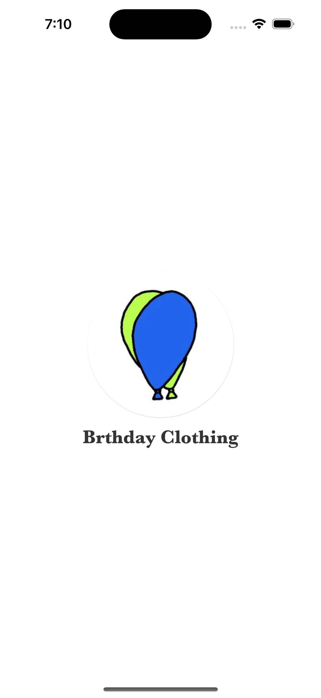
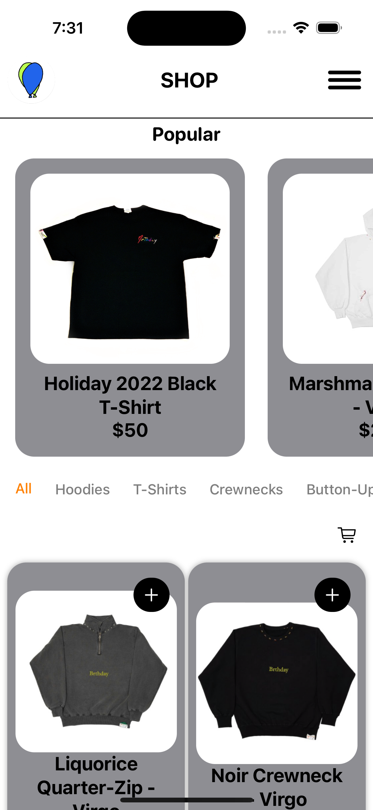
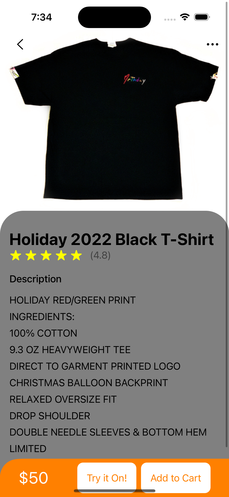

# Brthday Clothing — iOS App

Brthday Clothing is a SwiftUI shopping app for the Brthday streetwear brand. It was my capstone project for the Swift co-op (May–June 2023) and was presented on June 12, 2023.

<p align="center">
  
  
  
</p>

## Features
- **Animated splash screen** with the Brthday logo
- **Firebase Authentication:** sign up, log in, password reset, change email, sign out, and email validation
- **Home ("Explore")** with a featured "Hoodie of the Week" and a bottom navigation bar
- **Shop catalog** of about 24 products, filterable by category (Hoodies, T-Shirts, Crewnecks, Button-Ups, Quarter-Zips), with a Popular carousel and item detail pages
- **Cart** with a running total. One `CartManager` is shared across the app with `.environmentObject`, so the cart stays the same on every screen.
- **Account page** that loads and updates the username in Firebase Firestore
- **Archive / New Releases** galleries
- **Info pages:** About, Contact, Privacy Policy, Terms, Returns & Exchanges

## Tech stack
- SwiftUI, iOS 16.4 or later
- Firebase iOS SDK 10.x (Auth, Firestore, Analytics) through Swift Package Manager

## Project layout
```
BrthdayApp/
├── Brthday demo.xcodeproj            ← open this
├── Brthday-demo-Info.plist
├── GoogleService-Info.plist.example  ← template for your Firebase config
├── firestore.rules / firebase.json   ← Firestore security rules
└── Brthday demo/
    ├── App/            Brthday_demoApp.swift (entry point, owns the CartManager), ContentView.swift (screen router)
    ├── Models/         Product.swift (Product model + catalog data)
    ├── Managers/       CartManager.swift
    ├── Extensions/     String.swift (email validation)
    ├── Views/
    │   ├── Auth/       SplashScreenView, AuthView, LoginView, SignUpView
    │   ├── Shop/       HomeView, ShopView, NewView, ItemDescriptionView, MyArchiveView, ImageView
    │   ├── Components/ ProductCard, ProductCardView, ProductRow, CartButton
    │   ├── Cart/       CartView
    │   ├── Account/    AccountView, DropDownView
    │   └── Info/       AboutView, ContactView, PrivacyView, TermsView, ReturnsExchangesView
    ├── Assets.xcassets (product photos, logos, app icon)
    └── Preview Content/
```

## Running it

### 1. Firebase setup
The app needs a Firebase project. The real `GoogleService-Info.plist` isn't in the repo.

1. In the [Firebase Console](https://console.firebase.google.com/), create a project, or use your existing one.
2. Add an **iOS app** with bundle ID `com.smitj.Brthday`, or with your own ID; if you use your own, change it in Xcode as well.
3. Download `GoogleService-Info.plist` and put it in `BrthdayApp/`, next to `GoogleService-Info.plist.example`.
4. Under **Authentication → Sign-in method**, enable **Email/Password**.
5. Under **Firestore Database**, create a database and publish the rules from [`BrthdayApp/firestore.rules`](BrthdayApp/firestore.rules). You can paste them into the Rules tab, or run `firebase deploy --only firestore:rules` from `BrthdayApp/`. These rules let each signed-in user read and write only their own `users/{uid}` document.

### 2. Build
1. Open `BrthdayApp/Brthday demo.xcodeproj` in Xcode.
2. Let Swift Package Manager resolve the Firebase packages.
3. Choose an iPhone simulator and press Run.

## Other folders
| Folder | Contents |
|---|---|
| `Prototypes/brthday-testing/` | An early SwiftUI sandbox (May 2023) for trying out button and header styles |
| `Prototypes/unused-views/` | `ClothingReleasesView.swift`, a draft view that isn't part of the Xcode target |
| `Design/` | Keynote wireframe (*Birthday – Clothing Apparel*) and the final presentation (*June 12th – Brthday*) |
| `Media/Screenshots/` | iPhone 14 Pro simulator screenshots |
| `Media/Demo-Videos/` | Screen recordings of the app |

## Ideas for future improvement
- Swap the string-based `currentShowingView` router for `NavigationStack` with an enum of routes.
- Move the catalog data in `Product.swift` into Firestore or a JSON file.
- Create the `users/{uid}` document (with a username) at sign up instead of on the first username change.
