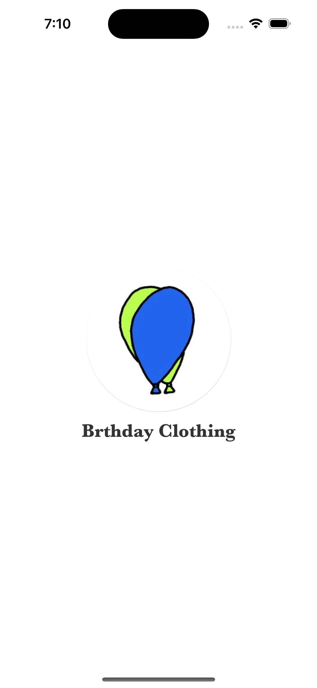
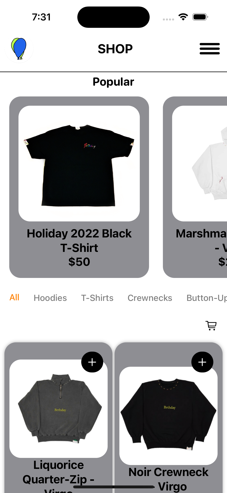
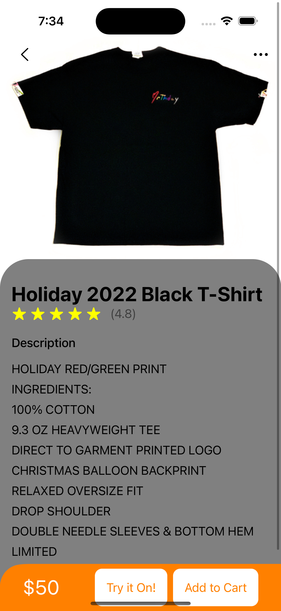

# Swift Development Co-op Portfolio

This is a compilation of the Xcode and Swift apps and algorithms I completed during the CEC Apple-partnered Co-op program (February – June 2023).

  
  
  

| Folder | What's inside |
|---|---|
| [`02-Brthday-iOS-App/`](02-Brthday-iOS-App/) | **Brthday Clothing**, my capstone SwiftUI and Firebase shopping app |
| [`01-Swift-Coop-Mini-Apps/`](01-Swift-Coop-Mini-Apps/) | The mini apps I built during the course: QuestionBot, ColorMix and BouncyBall |
| [`Other/`](Other/) | Java practice problems (not part of the Swift course) |

## Requirements
- macOS with Xcode 15 or later
- The Brthday app also needs network access so Swift Package Manager can fetch the Firebase SDK. See its README for Firebase setup.

## License
[MIT](LICENSE)
